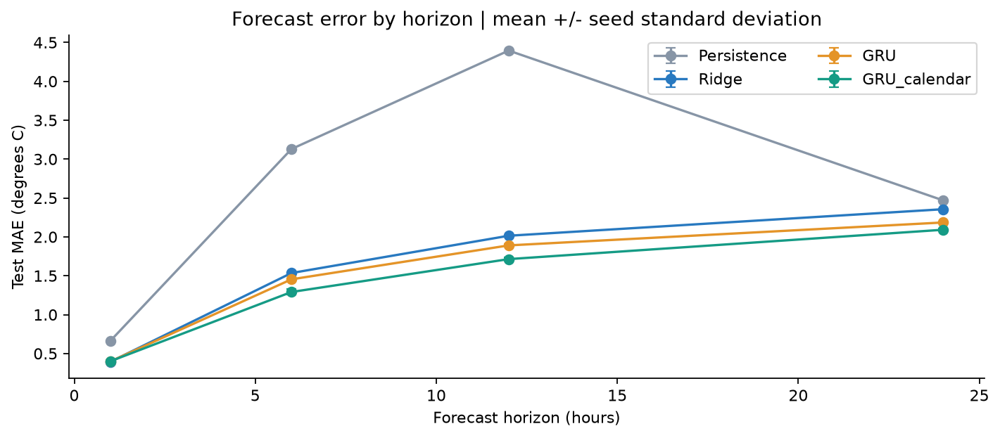
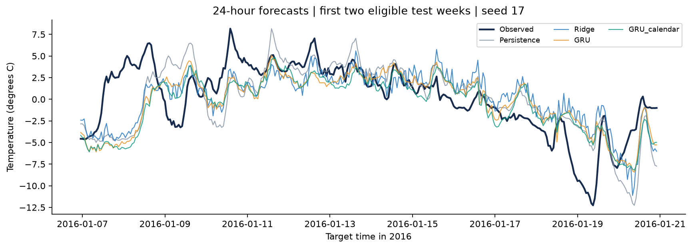
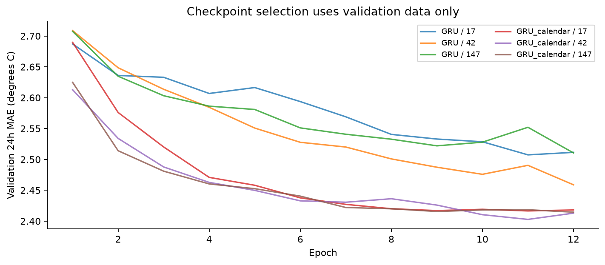

# JenaClimateForecasting

**EC417 P22.** Calendar features reduced GRU 24-hour test MAE by 0.094 degrees C (4.3%).

**M Sanjhay Baargav (623147)** and **Trinesh Kumar (623138)**  
Department of Electronics and Communication Engineering, NIT Andhra Pradesh.  
Repository name: `ec417-miniproject-P22-623147-623138`.

## Problem

Predict air temperature 24 hours ahead from the previous five days of hourly weather observations. Short-range temperature forecasting supports planning and provides a clear test of temporal modelling. Primary metric: mean absolute error (MAE) in degrees Celsius, because it directly expresses typical absolute error. Secondary metric: RMSE, which penalizes large mistakes more strongly.

## Data

Jena Climate 2009-2016: 420,551 raw records and 14 original variables. Source, CC BY 4.0 terms, download URL, attribution, hashes and preprocessing details are in [data/README.md](data/README.md) and [source_manifest.json](data/source_manifest.json). Class balance is not applicable to regression. Raw timestamps split into 2009-2014 training, 2015 validation and 2016 test before hourly resampling and window creation. Forward-fill within each period, then training medians. Training-only normalization. Invalid sentinel counts and exact boundaries are in [data_audit.json](results/data_audit.json).

All learned models use 17,467 training windows at stride 3; validation and test use hourly origins (8,617 and 8,544 windows). No input window or target crosses a split. Targets without observed hourly temperature are excluded from evaluation.

## Method

Persistence repeats the latest observed temperature. Ridge regression uses all 120 hourly inputs flattened into a vector; 2015 validation MAE selects alpha=1. The main model is a one-layer GRU with 24 hidden units and four linear outputs (1, 6, 12 and 24 hours). Both GRU variants use these same outputs, so the sole proposed improvement is adding sine/cosine of hour and day-of-year. Adam uses learning rate 0.003, batch size 256, up to 12 epochs, patience 3, and gradient clipping at 1. Training minimizes mean absolute error across the four standardized targets. Checkpoints minimize validation MAE at 24 hours. Normalization is reversed before reporting errors.

```text
Raw time split -> hourly means -> train-only preprocessing -> 120-hour windows
                                                      -> persistence / ridge / GRU
                                                      -> GRU + four calendar inputs
```

## Results

Test results at 24 hours. Mean +/- sample standard deviation across seeds 17, 42 and 147 for GRUs. Persistence and ridge are deterministic, evaluated once; their zero seed spread does not mean zero sampling uncertainty. Ridge time includes its validation penalty search; GRU time includes validation and early stopping, averaged per seed. Download/preprocessing/report time is excluded.

| Model | MAE (C) | RMSE (C) | Train time |
|---|---:|---:|---:|
| Persistence | 2.469 +/- 0.000 | 3.237 +/- 0.000 | 0.0 s |
| Ridge | 2.356 +/- 0.000 | 2.997 +/- 0.000 | 2.4 s |
| GRU | 2.185 +/- 0.005 | 2.815 +/- 0.004 | 40.4 s |
| GRU_calendar | 2.091 +/- 0.012 | 2.704 +/- 0.014 | 48.0 s |


Calendar features reduced GRU 24-hour test MAE by 0.094 degrees C (4.3%). Lowest observed mean MAE: **GRU_calendar**. Test results were computed after all model selection finished; no test score selected an epoch or penalty. This comparison does not claim statistical significance.





## Error analysis

The calendar GRU's largest monthly mean error occurs in month 1 (2.901 C across 601 forecast origins). For seed 17, the largest stored error is 11.44 C at 2016-05-23 19:00:00: actual 13.19 C versus prediction 24.63 C. Rapid temperature changes and missing spatial weather information are possible explanations, not verified causes.

The two-week chart uses the first eligible test fortnight and seed 17, chosen before inspecting results. Monthly errors average absolute errors across the three seeds, not ensemble predictions. See [monthly errors](results/monthly_errors.csv), [largest errors](results/largest_errors.csv), and the additional figures in `results/figures/`.

## Limitations and ethics

This experiment covers one station and one held-out year. Overlapping windows are correlated. Three-seed standard deviation quantifies optimization variability, not a confidence interval for future climates. Calendar features add a small number of input weights, so parameter counts are not exactly equal. Hourly averaging smooths extremes, imputation may distort unusual weather, and timestamps are used as provided without assuming a timezone conversion. The selected budget is modest and results do not establish the best possible GRU. This educational forecast is unsuitable for safety-critical weather alerts without further validation.

## Reproduce

Python 3.12 was used. From this directory, create an environment and run:

```bash
python -m venv .venv
# Windows PowerShell:
.venv/Scripts/Activate.ps1
# Linux/macOS: source .venv/bin/activate
python -m pip install -r requirements.txt
python run_project.py
python -m unittest discover -s tests -v
```

One command downloads the archived data, trains all models, selects on validation, evaluates test, and rebuilds this README, the report and notebook sources. It overwrites generated results. Keep the configuration fixed before final testing. CPU execution uses 2 PyTorch threads. Measured system: `Windows-11-10.0.26300-SP0`; processor: `Intel64 Family 6 Model 189 Stepping 1, GenuineIntel`. Total logged fitting/validation time: 267.5 seconds. End-to-end runtime varies with network and hardware. Checkpoints and raw data remain local and are ignored by Git.

To run stages separately: `python scripts/get_data.py`, `python -m src.train`, `python -m src.evaluate`, and `python scripts/build_deliverables.py`. Notebook 01 performs EDA; notebook 02 can reproduce experiments or inspect saved results. Execute both with `python scripts/check_notebooks.py`. `results/metrics.csv` contains model, seed, horizon, metric and value.

For a historical viva demonstration: `python -m src.predict --origin 2016-07-01T12:00:00`. This prints saved-model forecasts and observed temperatures for the four horizons; it is not a live weather service.

The six-page report is [report/report.pdf](report/report.pdf). See [submission checklist](docs/SUBMISSION_CHECKLIST.md) and [viva guide](docs/VIVA_GUIDE.md). The ten-slide demo content is in `report/demo_content.json`; the editable PowerPoint is [report/demo.pptx](report/demo.pptx).

## AI-use statement

OpenAI Codex assisted with guideline interpretation, implementation, checks, experiments, plots, and draft documentation. Automated checks and execution are recorded in this project. The students must review the code and results, record their own verification and contributions, and be able to explain the work at the viva. This statement does not claim that student review has already occurred.

## References

- [MPI weather data and terms](https://www.bgc-jena.mpg.de/wetter/weather_data.html)
- [TensorFlow time-series tutorial and archive provenance](https://www.tensorflow.org/tutorials/structured_data/time_series)
- [Cho et al. (2014), Learning Phrase Representations using RNN Encoder-Decoder](https://arxiv.org/abs/1406.1078)
- [Kingma and Ba (2014), Adam](https://arxiv.org/abs/1412.6980)
- [scikit-learn Ridge documentation](https://scikit-learn.org/stable/modules/generated/sklearn.linear_model.Ridge.html)
- Supplied EC417 project brief (P22 and submission pages), dataset guide and updated allocation table.
